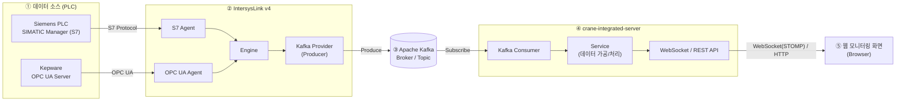

# crane-integrated-server

크레인 설비(PLC) 데이터를 Kafka에서 받아 가공한 뒤, 웹 모니터링 화면에 실시간으로 전달하는 Spring Boot 서버입니다.

## 아키텍처



이 저장소는 ④에 해당합니다. PLC 수집과 Kafka 적재는 IntersysLink v4가 담당하고, 이 서버는 토픽을 구독해 가공한 데이터를 WebSocket(STOMP)과 REST API로 브라우저에 제공합니다.

## 기술 스택

| 구분 | 사용 기술 |
|---|---|
| 언어 | Java 25 |
| 프레임워크 | Spring Boot 4.1.1 (Web MVC, WebSocket, Kafka, Validation, Actuator) |
| 빌드 | Gradle 9.7.1 (wrapper) |
| 메시징 | Apache Kafka |

## 시작하기

JDK 25가 설치되어 있어야 합니다.

```powershell
.\gradlew.bat build      # 빌드 + 테스트
.\gradlew.bat test       # 테스트
.\gradlew.bat bootRun    # 실행
```

Git Bash, macOS, Linux에서는 `.\gradlew.bat` 대신 `./gradlew`를 사용합니다.

서버는 `8080` 포트로 뜨고, 상태는 아래 주소로 확인합니다.

```
GET http://localhost:8080/actuator/health
```
