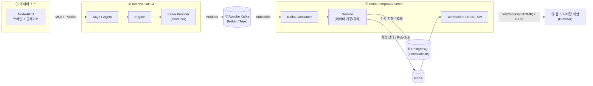

# crane-integrated-server

크레인 설비 데이터를 Kafka에서 받아 가공한 뒤, 웹 모니터링 화면에 실시간으로 전달하고 이력을 저장하는 Spring Boot 서버입니다.

## 시스템 구성



이 저장소는 ④에 해당합니다. 크레인 값은 Node-RED 크레인 시뮬레이터가 만들어 MQTT로 발행하고, 수집과 Kafka 적재는 IntersysLink v4의 MQTT Agent가 담당하며, 이 서버는 토픽을 구독만 합니다.

서버 안의 흐름은 다음과 같습니다.

```
Kafka ─▶ KafkaListener ─▶ TagIngestionService ─▶ 메모리 상태(크레인별, 변경 감지)
                                                       │ 변한 크레인
   250ms ─▶ SnapshotPushService ──▶ Redis HASH cis:crane:state ──▶ REST 조회
                                 └▶ Redis PUBLISH cis:crane:snapshots ─▶ 구독 ─▶ STOMP /topic/cranes, /topic/cranes/{id}
   1s    ─▶ HistoryRecordingService ─▶ HistoryWriter 큐 ─▶ 배치 INSERT crane_history / crane_history_diff
```

- 메시지는 태그 1개 단위 JSON입니다. `TagKey`는 `{bay}.{craneId}.{tagName}`, `Value`는 boolean 또는 숫자입니다.
- 값이 바뀐 크레인만 250ms 주기로 Redis에 저장·발행하고, WebSocket은 Redis 채널을 구독해 브라우저로 밀어 줍니다.
- 30초 동안 수신이 없는 크레인은 `online=false`로 표시합니다.
- 이력은 크레인당 1초마다 전체 상태 행(`crane_history`)과, 상태가 바뀐 시점의 전체 상태 행(`crane_history_diff`)을 TimescaleDB 하이퍼테이블에 저장합니다(30일 보존, 1일 경과분 압축).

## 코드 구조 (헥사고날)

```
com.hanwha.cis
├── domain.model      TagKey, TagValue, TagReading, TagState, CraneState, CraneSnapshot  (프레임워크 비의존)
├── application
│   ├── port.in       IngestTagReading / PushSnapshots / RecordHistory / QueryCraneState / QueryCraneHistory UseCase
│   ├── port.out      CraneStateStorePort(Redis), SnapshotPublisherPort(Redis 채널), CraneHistoryPort(DB), CraneRegistryPort(DB)
│   ├── service       CraneStateRegistry, TagIngestionService, SnapshotPushService, HistoryRecordingService, 조회 서비스
│   └── support       FailureLog(연속 실패 로그를 시작·지속·복구로 줄임), Durations
├── adapter
│   ├── in.kafka      CraneEventKafkaListener, KafkaListenerMetrics(cis.kafka.*)
│   ├── in.scheduler  SnapshotPushScheduler(250ms), HistoryRecordScheduler(1s), SummaryLogScheduler(60s), IngestWatchScheduler(5s),
│   │                 PushWatchScheduler(5s)
│   ├── in.web        CraneController, CraneHistoryController, ApiExceptionHandler(ProblemDetail)
│   ├── in.websocket  StompConfig, SnapshotStompBroadcaster, RedisSnapshotSubscriber
│   ├── out.redis     RedisCraneStateStore, RedisSnapshotPublisher
│   └── out.persistence HistoryWriter(전용 쓰기 스레드), JPA 엔티티·리포지토리, 어댑터
└── config            CisProperties(cis.*), ApplicationConfig, SchedulingConfig, KafkaConfig, RedisConfig, WebConfig, MetricsConfig,
                      RedisSubscriptionStarter(Redis 구독 백그라운드 재시도), RepeatedLogFilter(logback 반복 억제),
                      SkippedRecordLogger, StartupSummaryLogger
```

의존 방향(domain ← application ← adapter/config, 어댑터 간 의존 금지)은 `ArchitectureTest`(ArchUnit)가 강제합니다.

## 기술 스택

| 구분 | 사용 기술 |
|---|---|
| 언어 | Java 25 |
| 프레임워크 | Spring Boot 4.1.1 (Web MVC, WebSocket, Kafka, Data JPA, Data Redis, Flyway, Validation, Actuator) |
| 빌드 | Gradle 9.7.1 (wrapper) |
| 메시징 | Apache Kafka |
| 최신 상태 | Redis (해시 + Pub/Sub) |
| 데이터베이스 | PostgreSQL + TimescaleDB (스키마는 Flyway로 관리, 테스트는 H2) |

## 시작하기

JDK 25와 Podman, docker-compose가 필요합니다. `podman compose`는 설치된 docker-compose를 찾아 실행합니다. Windows·macOS는 Podman이 VM에서 돌므로 처음 한 번 `podman machine init`, 부팅 뒤마다 `podman machine start`를 합니다.

```powershell
podman compose up -d                     # 이 레포의 compose.yaml: timescaledb(5432) + redis(6379). .env 없이 그대로 쓴다
podman compose ps                        # 둘 다 healthy 인지 확인
.\gradlew.bat bootRun                    # 서버 실행 (8080)
```

Git Bash, macOS, Linux에서는 `.\gradlew.bat` 대신 `./gradlew`를 사용합니다.

기본 접속 정보는 다음과 같고, 환경 변수로 바꿀 수 있습니다.

| 대상 | 기본값 | 환경 변수 |
|---|---|---|
| Kafka | `localhost:29092`, 토픽 `ocean.crane.indoor.event`, 그룹 `crane-integrated-server` | `KAFKA_BOOTSTRAP_SERVERS` |
| PostgreSQL | `jdbc:postgresql://localhost:5432/cis` (cis / cis) | `DB_URL`, `DB_USERNAME`, `DB_PASSWORD` |
| Redis | `localhost:6379` | `REDIS_HOST`, `REDIS_PORT` |
| compose 포트 | 5432, 6379 (호스트 127.0.0.1에만 열림) | `CIS_DB_PORT`, `CIS_REDIS_PORT` |
| 로그 파일 위치 | `./logs` (실행 위치 기준) | `LOG_PATH` |

그 밖의 동작 설정은 `application.yaml`의 `cis.*`에 있습니다(푸시·이력 주기, 큐 크기, stale 기준, 조회 상한, CORS 허용 오리진, 느린 요청 기준 등).

### 컨테이너로 실행 (배포)

로컬과 배포는 같은 `compose.yaml`을 쓰고, 차이는 `.env` 파일로만 둡니다. 로컬은 `.env` 없이 기본값(DB·Redis만)으로 동작하고, 배포 서버는 `.env.prod.example`을 `.env`로 복사해 채웁니다. `.env`의 `COMPOSE_PROFILES=app` 덕분에 그 뒤로는 `podman compose up -d`, `ps`, `logs`, `down`이 서버(`app`)를 포함합니다. 파일 이름은 정확히 `.env`여야 compose가 자동으로 읽습니다. `.prod`는 템플릿이 배포 값이라는 표시일 뿐입니다.

```bash
cp .env.prod.example .env                          # 비밀번호·Kafka 주소·이미지 태그를 채운다(.env 는 git 에 올리지 않는다)
podman build -t crane-integrated-server:latest .   # 이미지 빌드(Containerfile). localhost/crane-integrated-server:latest 로 저장된다
                                                   # 태그는 .env 의 CIS_APP_TAG 와 맞춘다(다른 곳에서 빌드했으면 podman save/load)
podman compose up -d                               # DB·Redis·서버. 이미지가 없으면 여기서 빌드한다
podman compose ps                                  # 셋 다 healthy 인지 확인
podman compose logs -f app                         # 콘솔 로그
```

처음 배포하는 서버는 먼저 [배포 서버 준비](#배포-서버-준비)를 합니다.

로컬에서 서버까지 컨테이너로 띄워 보려면 `.env` 없이 `podman compose --profile app up -d --build`를 씁니다. 서버 컨테이너가 붙는 외부 네트워크 `isl-infra`가 있어야 하므로 ISL Kafka가 떠 있어야 하고, bootRun과 포트 8080·Kafka 컨슈머 그룹이 겹치니 둘을 같이 띄우지 않습니다.

서비스는 각각 올리고 내릴 수 있습니다.

```bash
podman compose stop app && podman compose up -d app    # 서버만 재기동. 이미지 태그를 바꿨으면 .env 수정 뒤 up -d app
podman compose restart redis                           # Redis만 재시작. 서버는 떠 있는 채로 푸시만 잠깐 멈추고 자동 복구
podman compose stop app                                # DB 작업 전에는 서버를 먼저 내린다(아래 참고)
podman compose restart timescaledb && podman compose up -d app
podman compose down app                                # 서버 컨테이너만 제거(DB·Redis 유지)
```

- `up -d app`은 `depends_on` 때문에 DB도 같이 올립니다. DB 없이 서버만 올리려면 `--no-deps`를 붙입니다.
- 서버가 떠 있는 채로 DB를 내리면 수집·푸시는 계속되지만, 이력 쓰기가 재시도 한도(연결 대기 30초 × 4회, 약 2분)를 넘기거나 큐(10,000건)가 차면 그 구간 이력은 버리고 ERROR로 남깁니다. 계획된 DB 작업은 서버를 먼저 내립니다.
- `podman compose down -v`는 DB 데이터 볼륨(`cis-pg`)을 지우므로 배포 서버에서는 쓰지 않습니다.
- 컨테이너 이름은 `cis-timescaledb`, `cis-redis`, `cis-app`으로 고정되어 있습니다. `podman logs -f cis-app`, `podman exec cis-redis redis-cli ping`처럼 compose 없이도 바로 지정할 수 있습니다.
- 재시작 정책: 서버는 항상 `unless-stopped`입니다. DB 없이 기동하면 종료하므로(Flyway 검증) DB가 뜰 때까지 다시 띄우고, Redis는 없어도 뜹니다. DB·Redis는 `.env`의 `CIS_RESTART`로 정합니다. Podman은 데몬이 없어서 재부팅 뒤 다시 띄우는 일은 `podman-restart.service`가 합니다([배포 서버 준비](#배포-서버-준비)).
- 헬스 체크는 `/actuator/health/liveness`만 봅니다. 전체 `/actuator/health`는 Redis가 없으면 DOWN이지만 Redis는 재시작 사유가 아니기 때문입니다.
- 서버 컨테이너는 `CIS_APP_MEMORY`(기본 1g)로 메모리를 제한하고 JVM 힙 최대치는 그 75%입니다.
- 콘솔 로그는 서비스마다 50MB까지 남습니다. Podman은 보관 개수(`max-file`)가 없어 상한에 닿으면 앞부분이 지워지므로, 지난 로그는 아래 로그 파일에서 봅니다.
- 로그 파일은 `cis-logs` 볼륨의 `/app/logs`에 남습니다. 예: `podman compose exec app tail -n 100 /app/logs/cis-error.log`
- DB·Redis 포트는 호스트 `127.0.0.1`에만 열립니다. 외부에 여는 포트는 서버(8080)뿐이고, 다른 호스트에서 DB에 붙어야 하면 SSH 터널을 씁니다.
- Kafka는 브로커가 **광고하는 주소**로 붙어야 합니다. ISL Kafka는 호스트 쪽으로 `localhost:29092`, 컨테이너 쪽으로 `kafka:9092`(같은 서버·같은 계정 Podman의 네트워크 `isl-infra`)를 광고하므로 서버 컨테이너는 `isl-infra`에 붙어 `kafka:9092`를 씁니다. 다른 환경이면 `.env`에서 바꿉니다.

`.env` 변수(모두 선택, 없으면 기본값 = 로컬 설정):

| 변수 | 기본값 | 의미 |
|---|---|---|
| `COMPOSE_PROFILES` | (없음) | `app`이면 서버까지 compose 대상에 포함 |
| `CIS_RESTART` | `no` | DB·Redis 재시작 정책. 배포는 `unless-stopped` |
| `CIS_DB_PASSWORD` | `cis` | DB 비밀번호(초기화와 서버 접속에 공용). DB 볼륨을 처음 만들 때만 반영 |
| `CIS_APP_TAG` | `latest` | 서버 이미지 태그. 롤백은 태그를 바꾸고 `up -d app` |
| `CIS_APP_MEMORY` | `1g` | 서버 컨테이너 메모리 상한 |
| `CIS_KAFKA_BOOTSTRAP_SERVERS` | `kafka:9092` | 서버 컨테이너가 붙을 Kafka 주소 |
| `CIS_KAFKA_NETWORK` | `isl-infra` | Kafka가 있는 외부 Podman 네트워크(ISL과 같은 계정에 미리 있어야 함) |
| `CIS_DB_PORT`, `CIS_REDIS_PORT` | `5432`, `6379` | 호스트 127.0.0.1에 여는 DB·Redis 포트 |
| `CIS_APP_PORT` | `8080` | 호스트에 여는 서버 포트 |

### 배포 서버 준비

배포 서버에서 한 번만 합니다. 명령은 모두 **ISL을 띄운 계정**으로 실행합니다. 서버 컨테이너가 ISL의 `isl-infra` 네트워크에 붙어야 하는데, Podman 네트워크는 계정마다(rootless), 그리고 rootful·rootless마다 따로 있기 때문입니다.

```bash
podman info --format '{{.Host.NetworkBackend}} {{.Host.CgroupsVersion}}'   # netavark v2 여야 한다
podman compose version                           # compose 실행기. docker-compose v2 권장(podman-compose 면 최신 버전)
podman network inspect isl-infra                 # ISL 네트워크가 있고 "dns_enabled": true 인지
systemctl --user enable podman-restart.service   # 재부팅 뒤 컨테이너를 다시 띄운다(rootful 이면 sudo systemctl enable podman-restart.service)
loginctl enable-linger $USER                     # rootless 만. 로그아웃해도 컨테이너와 헬스 체크가 계속 돈다
```

- `netavark`(Podman 4 이상)여야 서버 컨테이너가 두 네트워크(`cis_default`, `isl-infra`)에 같이 붙어 `timescaledb`·`redis`·`kafka`를 이름으로 찾습니다.
- `podman-restart.service`가 없으면 재부팅 뒤 아무것도 뜨지 않습니다. 직접 `stop`한 컨테이너는 다시 띄우지 않습니다(`unless-stopped`). 재부팅 뒤 컨테이너가 뜨지 않으면(구버전 Podman) 재시작 정책을 `always`로 바꿉니다.
- 헬스 체크는 systemd 타이머로 돕니다. rootless에서 linger가 없으면 로그아웃과 함께 멈추고, DB가 healthy가 되지 않아 서버가 뜨지 않습니다.
- 메모리 상한은 cgroup `v2`여야 걸립니다. 안 걸리면 JVM 힙이 호스트 RAM 기준으로 잡히니 기동 뒤 `podman stats --no-stream cis-app`의 MEM LIMIT이 `CIS_APP_MEMORY`인지 봅니다.
- rootless는 포트를 일반 프로세스로 열어 호스트 방화벽을 그대로 따릅니다. 외부에서 8080에 붙으려면 방화벽에서 엽니다.
- 기존 DB 볼륨을 이어 쓰면 `CIS_DB_PASSWORD`를 그 볼륨을 만들 때의 비밀번호(`.env` 없이 만들었으면 `cis`)와 맞춥니다. 바꾸려면 먼저 `ALTER USER cis PASSWORD '…'`를 실행합니다.

## API

REST (`/api`, 오류는 RFC 9457 ProblemDetail):

| 메서드·경로 | 파라미터 | 응답 |
|---|---|---|
| `GET /api/cranes` | – | 크레인 스냅샷 목록 |
| `GET /api/cranes/{craneId}` | – | 스냅샷 1건 (없으면 404) |
| `GET /api/cranes/{craneId}/history` | `from`, `to` (ISO-8601, 필수), `step` (기본 1s, 예: `5s`, `1m`) | baseline + step 간격 프레임(sample-and-hold) |
| `GET /api/cranes/{craneId}/changes` | `from`, `to`, `after` (커서), `limit` (기본 500, 최대 5000) | 상태가 변한 시점의 행 + `nextCursor` |

범위는 최대 1시간, 프레임 수는 최대 5000개이며 넘으면 400입니다. DB에 접근하지 못하면 `history`·`changes`는 503입니다.
`from`이 현재 시각 이후면 400이고, `to`가 현재 시각 이후면 현재까지로 자릅니다(`history`는 `from` 기준 step 격자에서 현재 이하의 마지막 프레임까지 만들고, 응답 `to`에 잘린 끝 시각을 담습니다).

스냅샷 형태:

```json
{"craneId":"C_867","stationId":"isl-ocean-crane","bay":"F5_1_Bay",
 "snapshotAt":"2026-10-19T05:23:16.993Z","lastReceivedAt":"2026-10-19T05:23:17.001Z","online":true,
 "tags":{"tl_status":{"value":false,"quality":0,"timestamp":"2026-10-19T05:23:16.993Z"}, "...":{}}}
```

WebSocket (STOMP, SockJS 없음):

- 엔드포인트 `ws://localhost:8080/ws`
- `/topic/cranes` — 250ms 틱마다 변한 크레인 묶음 `{"type":"snapshot","sentAt":...,"cranes":[스냅샷...]}`
- `/topic/cranes/{craneId}` — 크레인별 스냅샷 1건
- 구독 직후 초기 화면은 `GET /api/cranes`로 채웁니다.

허용 오리진은 `cis.web.allowed-origins`(기본 `http://localhost:*`)로 REST CORS와 STOMP 핸드셰이크에 같이 적용됩니다.

## 확인 방법

```
GET http://localhost:8080/actuator/health      # db, redis 인디케이터 포함
GET http://localhost:8080/actuator/health/liveness   # 프로세스 자체 상태(컨테이너 헬스 체크용, 외부 의존성 제외)
GET http://localhost:8080/actuator/metrics     # cis.ingest.*, cis.kafka.*, cis.history.*, cis.ws.sessions, cis.cranes.*
```

- 서버 로그에 60초마다 요약 한 줄이 찍힙니다(아래 [로그](#로그) 참고).
- Redis: `podman exec cis-redis redis-cli HLEN cis:crane:state` (크레인 수), `SUBSCRIBE cis:crane:snapshots`
- DB: `psql -h localhost -U cis -d cis -c "select crane_id, count(*) from crane_history group by 1"`
- DB(TimescaleDB)를 잠시 내려도 수집·푸시는 계속되고, 이력은 큐에 쌓였다가(`cis.history.queue_size`) 복구 후 빠집니다. 다만 쓰기 재시도 한도(연결 대기 30초 × 4회, 약 2분)를 넘긴 배치나 큐(10,000건)가 찬 뒤의 행은 버리고 ERROR로 남깁니다. 기동할 때는 DB가 있어야 합니다(Flyway 검증).
- Redis는 기동할 때 없어도 됩니다. 없는 동안 수집·이력·REST(메모리 상태)는 계속되고 화면 실시간 푸시만 멈추며, Redis가 붙으면 구독과 푸시가 자동으로 이어집니다.

## 로그

시각은 KST(`+09:00`)로, 메시지는 영어로 남깁니다.

| 출력 | 내용 |
|---|---|
| 콘솔(stdout) | INFO 이상. 컨테이너에서는 `podman compose logs app` |
| `${LOG_PATH}/cis.log` | INFO 이상 전부 |
| `${LOG_PATH}/cis-error.log` | WARN 이상만. 문제가 생기면 이 파일부터 봅니다 |

- 파일은 날짜별·50MB 단위로 나눠 `.gz`로 보관하고 30일이 지나면 지웁니다. 용량 상한은 `cis.log` 1.5GB, `cis-error.log` 512MB입니다(`logging.logback.rollingpolicy.*`).
- 컨테이너로 띄울 때는 `LOG_PATH`를 볼륨에 연결해야 컨테이너를 다시 만들어도 파일이 남습니다. compose `app` 서비스는 `cis-logs` 볼륨을 `/app/logs`에 연결해 둡니다.
- `test` 프로필은 콘솔에만 찍습니다.
- Kafka 클라이언트의 INFO 로그는 끄고, Kafka·Redis·DB 라이브러리의 같은 WARN·ERROR는 1분에 한 번만 남깁니다(`logback-spring.xml`).

문제가 생겼을 때 찾아볼 줄:

| 로그 | 의미 |
|---|---|
| `Ready \| kafka=… topic=… \| db=… \| redis=… \| logs=…` | 기동 완료. 실제로 붙은 주소 |
| `Kafka ingest started` / `Kafka ingest resumed after …` | 수신 시작·복구 |
| `Kafka ingest stopped: no connection to broker …` | Kafka 브로커에 연결 안 됨. ISL Kafka 컨테이너와 주소·포트 확인 |
| `Kafka ingest stopped: connected to … but no partition of topic … is assigned` | 토픽이 없거나, 브로커가 알려 주는 주소(advertised listener)에 이 서버가 접근하지 못함 |
| `Kafka ingest stopped: connected with N partition(s) … but no messages` | Kafka는 정상이고 상류(ISL Kafka Provider·MQTT Agent·Node-RED)가 발행하지 않음 |
| `Cranes offline, no data for 30s …` / `Cranes online …` | 크레인별 수신 끊김·복귀 |
| `Live push stalled: …` / `Live push resumed after …` | Redis 발행은 되는데 구독으로 돌아오지 않아 웹 화면이 갱신되지 않음. Redis 구독 상태 확인 |
| `History writes dropped: N failed to write (time … ~ …), …` | 이력을 버렸음(ERROR, 1분마다). `time` 범위가 DB에 비는 구간 = 리플레이 공백 |
| `History writes no longer dropped: …` | 이력 유실이 끝남(총 건수·기간) |
| `Slow request: GET /api/… -> 200 in 2345 ms (remote …)` | 1초(`cis.web.slow-request-threshold`) 이상 걸린 REST 요청. 요청마다 남기는 access log는 없음 |
| `… failed: …` → `… still failing for …` → `… recovered after …` | Redis·DB 등 연속 실패의 시작·지속(1분마다)·복구 |
| `Kafka listener failed, record skipped: …` | 메시지 처리 중 예외(버그). 같은 원인은 1분에 한 건 |
| `…: suppressed N repeat(s) of the following message in the last …` | 바로 다음 줄의 라이브러리 경고가 그동안 N번 더 났음 |

60초 요약 한 줄:

```
ingest received=… changed=… skipped=… (parse=… mismatch=… late=…) | kafka connections=… partitions=…
  | history rows=…/… queue=… failures=… dropped=… | push published=… forwarded=… | ws sessions=… | cranes online=…/…
```

`push`는 Redis 채널에 발행한 메시지 수와 구독으로 받아 STOMP로 넘긴 메시지 수입니다. 정상이면 같습니다.

## 테스트

```powershell
.\gradlew.bat test
```

테스트는 `test` 프로필로 돌며 H2(PostgreSQL 모드)를 씁니다. Kafka는 EmbeddedKafka로, Redis는 in-memory 포트 구현으로 대체하므로 외부 인프라 없이 실행됩니다. `CraneIngestionEndToEndTest`가 실제 형식의 메시지를 넣어 REST 응답, DB 행, STOMP 수신까지 확인합니다.
