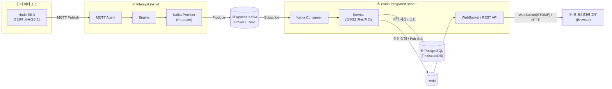

# crane-integrated-server

크레인 설비 데이터를 Kafka에서 받아 가공한 뒤, 웹 모니터링 화면에 실시간으로 전달하고 이력을 저장하는 Spring Boot 서버입니다.

## 시스템 구성



이 저장소는 ④에 해당합니다. 크레인 값은 Node-RED 크레인 시뮬레이터가 만들어 MQTT로 발행하고, 수집과 Kafka 적재는 IntersysLink v4의 MQTT Agent가 담당하며, 이 서버는 토픽을 구독만 합니다.

토픽은 내업(indoor) `ocean.crane.indoor.event`와 외업(outdoor) `ocean.crane.outdoor.event` 두 개입니다. 둘은 같은 메모리 상태·Redis·이력 테이블을 쓰고, 화면으로 나가는 REST·STOMP 경로만 나뉩니다(스냅샷의 `scope`).

서버 안의 흐름은 다음과 같습니다.

```
indoor  ─▶ IndoorCraneEventKafkaListener  ─▶ IndoorTagIngestionService  ─┐
outdoor ─▶ OutdoorCraneEventKafkaListener ─▶ OutdoorTagIngestionService ─┴▶ 메모리 상태(크레인별, 변경 감지)
                                                       │ 변한 크레인
   250ms ─▶ SnapshotPushService ──▶ Redis HASH cis:crane:state ──▶ REST 조회 /api/indoor/cranes, /api/outdoor/cranes
                                 └▶ Redis PUBLISH cis:crane:snapshots ─▶ 구독 ─▶ STOMP /topic/indoor/cranes, /topic/outdoor/cranes
   1s    ─▶ HistoryRecordingService ─▶ HistoryWriter 큐 ─▶ 배치 INSERT crane_history / crane_history_diff
```

- 메시지는 태그 1개 단위 JSON입니다. 내업은 `TagKey`가 `{bay}.{craneId}.{tagName}`입니다. `Value`는 boolean, 숫자, 또는 값 없음(JSON `null`, 문자열 `"NULL"`)이고 값 없음은 스냅샷에 `null`로 들어갑니다.
- 값이 바뀐 크레인만 250ms 주기로 Redis에 저장·발행하고, WebSocket은 Redis 채널을 구독해 브라우저로 밀어 줍니다.
- 30초 동안 수신이 없는 크레인은 `online=false`로 표시합니다.
- 이력은 크레인당 1초마다 전체 상태 행(`crane_history`)과, 상태가 바뀐 시점의 전체 상태 행(`crane_history_diff`)을 TimescaleDB 하이퍼테이블에 저장합니다(30일 보존, 1일 경과분 압축).

### 외업(outdoor) 크레인 해석

외업 메시지는 크레인 1대가 아니라 외업 PLC 1대가 보냅니다. 레코드 키와 봉투 `craneId`는 PLC 장비 이름이고, 그 안에 크레인 슬롯 30개(`CR01`~`CR30`)와 공통 블록이 들어 있습니다. 서버는 이 구조만 크레인 단위로 바꾸고, 태그 이름과 값은 원본 그대로 둡니다.

- 슬롯 태그는 `4_Crane.4_CR{nn}.`으로 시작합니다. 슬롯의 `4_Crane.4_CR{nn}.00_Crane_ID_{n}` 값이 그 슬롯에 들어 있는 크레인입니다.
- Crane_ID 숫자는 백의 자리(4자리면 천의 자리)로 타입을 정해 craneId로 바꿉니다: 101 → `GC_01`, 207 → `TTC_07`, 348 → `TC_48`, 3104 → `TC_104`, 417 → `OC_17`, 452 → `CC_52`, 501 → `LLC_01`. 0은 미배정이고, 규칙 밖 숫자는 `ID_{숫자}`로 두고 WARN을 남깁니다.
- 크레인 스냅샷의 태그는 그 슬롯의 원본 TagKey 그대로입니다(예: `4_Crane.4_CR01.4_POS.03_Center_POS_x1`). `bay`는 PLC 장비 이름입니다.
- 슬롯마다 태그의 최근 값을 보관합니다. Crane_ID가 바뀌면 새 크레인의 태그를 슬롯 보관값으로 통째로 바꿉니다(이전 슬롯 이름의 태그는 지움). 슬롯에서 빠진 크레인은 갱신이 멈춰 30초 뒤 offline이 됩니다.
- 같은 Crane_ID가 두 슬롯에 오면 먼저 잡은 슬롯만 반영하고 WARN을 남깁니다.
- 크레인 슬롯 밖의 공통 블록(PLC 시각, 최근접 충돌정보, 프리셋, 레일, 장애물, 통신에러)은 받지 않고 `common`으로 셉니다.
- 레코드 키가 하나라 파티션 하나에만 들어오므로 외업 리스너 스레드는 1개입니다. 컨슈머 그룹은 내업(`{그룹}-indoor`)과 따로 `{그룹}-outdoor`입니다.

## 코드 구조 (헥사고날)

```
com.hanwha.cis
├── domain.model      TagKey, TagValue, TagReading, TagState, CraneState, CraneSnapshot, CraneScope(indoor/outdoor),
│                     OutdoorCraneId(Crane_ID → craneId)  (프레임워크 비의존)
├── application
│   ├── port.in       IngestIndoorTag / IngestOutdoorTag / PushSnapshots / RecordHistory / QueryCraneState / QueryCraneHistory UseCase,
│   │                 RawTagEvent(두 범위 공용)
│   ├── port.out      CraneStateStorePort(Redis), SnapshotPublisherPort(Redis 채널), CraneHistoryPort(DB), CraneRegistryPort(DB)
│   ├── service       CraneStateRegistry, IndoorTagIngestionService, OutdoorTagIngestionService, SnapshotPushService,
│   │                 HistoryRecordingService, 조회 서비스
│   └── support       FailureLog(연속 실패 로그를 시작·지속·복구로 줄임), Durations
├── adapter
│   ├── in.kafka      IndoorCraneEventKafkaListener, OutdoorCraneEventKafkaListener, KafkaListenerMetrics(cis.kafka.*)
│   ├── in.scheduler  SnapshotPushScheduler(250ms), HistoryRecordScheduler(1s), SummaryLogScheduler(60s), IngestWatchScheduler(5s),
│   │                 PushWatchScheduler(5s)
│   ├── in.web        IndoorCraneController, OutdoorCraneController, CraneHistoryController(두 범위), ApiExceptionHandler(ProblemDetail)
│   ├── in.websocket  StompConfig, SnapshotStompBroadcaster, RedisSnapshotSubscriber
│   ├── out.redis     RedisCraneStateStore, RedisSnapshotPublisher
│   └── out.persistence HistoryWriter(전용 쓰기 스레드), JPA 엔티티·리포지토리, 어댑터
└── config            CisProperties(cis.*), ApplicationConfig, SchedulingConfig, KafkaConfig, RedisConfig, WebConfig, MetricsConfig,
                      RedisSubscriptionStarter(Redis 구독 백그라운드 재시도), RepeatedLogFilter(logback 반복 억제),
                      SkippedRecordLogger, StartupSummaryLogger
```

의존 방향(domain ← application ← adapter/config, 어댑터 간 의존 금지)은 `ArchitectureTest`(ArchUnit)가 강제합니다.

## 기술 스택

| 구분 | 사용 기술 |
|---|---|
| 언어 | Java 25 |
| 프레임워크 | Spring Boot 4.1.1 (Web MVC, WebSocket, Kafka, Data JPA, Data Redis, Flyway, Validation, Actuator) |
| 빌드 | Gradle 9.7.1 (wrapper) |
| 메시징 | Apache Kafka |
| 최신 상태 | Redis (해시 + Pub/Sub) |
| 데이터베이스 | PostgreSQL + TimescaleDB (스키마는 Flyway로 관리, 테스트는 H2) |

## 시작하기

JDK 25와 컨테이너 엔진(Docker 또는 Podman)이 필요합니다. 이 문서의 명령은 Podman 기준이고, Docker에서는 `podman`을 `docker`로 바꿔 씁니다(`podman compose` → `docker compose`).

- Docker: Docker Desktop(Windows·macOS) 또는 Docker Engine과 Compose v2 플러그인.
- Podman: docker-compose가 함께 필요합니다. `podman compose`는 설치된 docker-compose를 찾아 실행합니다. Windows·macOS는 Podman이 VM에서 돌므로 처음 한 번 `podman machine init`, 부팅 뒤마다 `podman machine start`를 합니다.

```powershell
podman compose up -d                     # 이 레포의 compose.yaml: timescaledb(5432) + redis(6379). .env 없이 그대로 쓴다
podman compose ps                        # 둘 다 healthy 인지 확인
.\gradlew.bat bootRun                    # 서버 실행 (8080)
```

Git Bash, macOS, Linux에서는 `.\gradlew.bat` 대신 `./gradlew`를 사용합니다.

기본 접속 정보는 다음과 같고, 환경 변수로 바꿀 수 있습니다.

| 대상 | 기본값 | 환경 변수 |
|---|---|---|
| Kafka | `localhost:29092`, 토픽 `ocean.crane.indoor.event`(그룹 `crane-integrated-server-indoor`), `ocean.crane.outdoor.event`(그룹 `crane-integrated-server-outdoor`) | `KAFKA_BOOTSTRAP_SERVERS` |
| PostgreSQL | `jdbc:postgresql://localhost:5432/cis` (cis / cis) | `DB_URL`, `DB_USERNAME`, `DB_PASSWORD` |
| Redis | `localhost:6379` | `REDIS_HOST`, `REDIS_PORT` |
| compose 포트 | 5432, 6379 (호스트 127.0.0.1에만 열림) | `CIS_DB_PORT`, `CIS_REDIS_PORT` |
| 로그 파일 위치 | `./logs` (실행 위치 기준) | `LOG_PATH` |

그 밖의 동작 설정은 `application.yaml`의 `cis.*`에 있습니다(토픽 `cis.kafka.indoor.*`·`cis.kafka.outdoor.*`, 푸시·이력 주기, 큐 크기, stale 기준, 조회 상한, CORS 허용 오리진, 느린 요청 기준 등). 컨슈머 그룹은 `spring.kafka.consumer.group-id` 뒤에 `-indoor`·`-outdoor`를 붙인 이름입니다.

### 컨테이너로 실행 (배포)

로컬과 배포는 같은 `compose.yaml`을 쓰고, 차이는 `.env` 파일로만 둡니다. 로컬은 `.env` 없이 기본값(DB·Redis만)으로 동작하고, 배포 서버는 `.env.prod.example`을 `.env`로 복사해 채웁니다. `.env`의 `COMPOSE_PROFILES=app` 덕분에 그 뒤로는 `podman compose up -d`, `ps`, `logs`, `down`이 서버(`app`)를 포함합니다. 파일 이름은 정확히 `.env`여야 compose가 자동으로 읽습니다. `.prod`는 템플릿이 배포 값이라는 표시일 뿐입니다. 엔진은 Docker와 Podman 둘 다 되며, 서버 컨테이너는 ISL Kafka와 같은 엔진에 띄웁니다([컨테이너 엔진](#컨테이너-엔진)).

```bash
cp .env.prod.example .env      # 비밀번호·Kafka 주소·이미지 태그를 채운다(.env 는 git 에 올리지 않는다)
podman compose build app       # 서버 이미지 빌드(Dockerfile) → localhost/crane-integrated-server:<CIS_APP_TAG>
podman compose up -d           # DB·Redis·서버
podman compose ps              # 셋 다 healthy 인지 확인
podman compose logs -f app     # 콘솔 로그
```

이미지 이름과 태그는 compose가 `image:`(`localhost/crane-integrated-server:${CIS_APP_TAG}`)대로 붙입니다. compose 밖에서 빌드하거나 다른 서버에서 `save`/`load`로 가져올 때도 이 이름을 `localhost/`까지 그대로 씁니다. Docker는 짧은 이름(`crane-integrated-server`)을 `docker.io/library/`로 저장하기 때문에 compose가 찾지 못하고 소스에서 다시 빌드합니다.

처음 배포하는 서버는 엔진별 가이드([Docker](docs/deploy-docker.md), [Podman](docs/deploy-podman.md))의 서버 준비부터 합니다. 업데이트·롤백 절차(내업 컨슈머 그룹을 옮기는 1회 절차 포함)도 거기 있습니다.

로컬에서 서버까지 컨테이너로 띄워 보려면 `.env` 없이 `podman compose --profile app up -d --build`를 씁니다. 서버 컨테이너가 붙는 외부 네트워크 `isl-infra`가 있어야 하므로 ISL Kafka가 같은 엔진에 떠 있어야 하고, bootRun과 포트 8080·Kafka 컨슈머 그룹이 겹치니 둘을 같이 띄우지 않습니다.

서비스는 각각 올리고 내릴 수 있습니다.

```bash
podman compose stop app && podman compose up -d app    # 서버만 재기동. 이미지 태그를 바꿨으면 .env 수정 뒤 up -d app
podman compose restart redis                           # Redis만 재시작. 서버는 떠 있는 채로 푸시만 잠깐 멈추고 자동 복구
podman compose stop app                                # DB 작업 전에는 서버를 먼저 내린다(아래 참고)
podman compose restart timescaledb && podman compose up -d app
podman compose down app                                # 서버 컨테이너만 제거(DB·Redis 유지)
```

- `up -d app`은 `depends_on` 때문에 DB도 같이 올립니다. DB 없이 서버만 올리려면 `--no-deps`를 붙입니다.
- 서버가 떠 있는 채로 DB를 내리면 수집·푸시는 계속되지만, 이력 쓰기가 재시도 한도(연결 대기 30초 × 4회, 약 2분)를 넘기거나 큐(10,000건)가 차면 그 구간 이력은 버리고 ERROR로 남깁니다. 계획된 DB 작업은 서버를 먼저 내립니다.
- `podman compose down -v`는 DB 데이터 볼륨(`cis-pg`)을 지우므로 배포 서버에서는 쓰지 않습니다.
- 컨테이너 이름은 `cis-timescaledb`, `cis-redis`, `cis-app`으로 고정되어 있습니다. `podman logs -f cis-app`, `podman exec cis-redis redis-cli ping`처럼 compose 없이도 바로 지정할 수 있습니다.
- 재시작 정책: 서버는 항상 `unless-stopped`입니다. DB 없이 기동하면 종료하므로(Flyway 검증) DB가 뜰 때까지 다시 띄우고, Redis는 없어도 뜹니다. DB·Redis는 `.env`의 `CIS_RESTART`로 정합니다. 재부팅 뒤 다시 띄우는 일은 Docker는 데몬이, Podman은 `podman-restart.service`가 합니다([컨테이너 엔진](#컨테이너-엔진)).
- 헬스 체크는 `/actuator/health/liveness`만 봅니다. 전체 `/actuator/health`는 Redis가 없으면 DOWN이지만 Redis는 재시작 사유가 아니기 때문입니다.
- 서버 컨테이너는 `CIS_APP_MEMORY`(기본 1g)로 메모리를 제한하고 JVM 힙 최대치는 그 75%입니다.
- 콘솔 로그는 서비스마다 50MB까지 남습니다. 보관 파일이 없어(Podman은 `max-file`이 없고 Docker도 기본 1개) 상한에 닿으면 지난 로그가 지워지므로, 지난 로그는 아래 로그 파일에서 봅니다.
- 로그 파일은 `cis-logs` 볼륨의 `/app/logs`에 남습니다. 예: `podman compose exec app tail -n 100 /app/logs/cis-error.log`
- DB·Redis 포트는 호스트 `127.0.0.1`에만 열립니다. 외부에 여는 포트는 서버(8080)뿐이고, 다른 호스트에서 DB에 붙어야 하면 SSH 터널을 씁니다.
- Kafka는 브로커가 **광고하는 주소**로 붙어야 합니다. ISL Kafka는 호스트 쪽으로 `localhost:29092`, 컨테이너 쪽으로 `kafka:9092`(같은 서버·같은 엔진의 네트워크 `isl-infra`)를 광고하므로 서버 컨테이너는 `isl-infra`에 붙어 `kafka:9092`를 씁니다. 다른 환경이면 `.env`에서 바꿉니다.

`.env` 변수(모두 선택, 없으면 기본값 = 로컬 설정):

| 변수 | 기본값 | 의미 |
|---|---|---|
| `COMPOSE_PROFILES` | (없음) | `app`이면 서버까지 compose 대상에 포함 |
| `CIS_RESTART` | `no` | DB·Redis 재시작 정책. 배포는 `unless-stopped` |
| `CIS_DB_PASSWORD` | `cis` | DB 비밀번호(초기화와 서버 접속에 공용). DB 볼륨을 처음 만들 때만 반영 |
| `CIS_APP_TAG` | `latest` | 서버 이미지 태그. 바꾸면 `compose build app` 뒤 `up -d app`, 롤백은 이전 태그로 되돌리고 `up -d app` |
| `CIS_APP_MEMORY` | `1g` | 서버 컨테이너 메모리 상한 |
| `CIS_KAFKA_BOOTSTRAP_SERVERS` | `kafka:9092` | 서버 컨테이너가 붙을 Kafka 주소 |
| `CIS_KAFKA_NETWORK` | `isl-infra` | Kafka가 있는 외부 네트워크(ISL과 같은 엔진, Podman이면 같은 계정에 미리 있어야 함) |
| `CIS_DB_PORT`, `CIS_REDIS_PORT` | `5432`, `6379` | 호스트 127.0.0.1에 여는 DB·Redis 포트 |
| `CIS_APP_PORT` | `8080` | 호스트에 여는 서버 포트 |

기존 DB 볼륨을 이어 쓰면 `CIS_DB_PASSWORD`를 그 볼륨을 만들 때의 비밀번호(`.env` 없이 만들었으면 `cis`)와 맞춥니다. 바꾸려면 먼저 `ALTER USER cis PASSWORD '…'`를 실행합니다.

### 컨테이너 엔진

Docker와 Podman 둘 다 지원합니다. `compose.yaml`과 `Dockerfile`은 두 엔진에서 똑같이 동작하는 설정만 쓰므로 명령 앞의 `docker`/`podman`만 다릅니다. 서버 컨테이너는 ISL Kafka의 `isl-infra` 네트워크에 붙어야 하고 네트워크는 엔진마다 따로 있으므로, **ISL이 도는 엔진**을 씁니다(Podman은 같은 계정, 같은 rootful/rootless).

배포 서버 준비, 첫 배포, 업데이트·롤백, 문제 해결은 엔진별 가이드에 있습니다.

- [docs/deploy-docker.md](docs/deploy-docker.md): Docker Engine, Docker Desktop
- [docs/deploy-podman.md](docs/deploy-podman.md): Podman(rootless, rootful)

운영에서 다른 점:

| | Docker | Podman |
|---|---|---|
| 재부팅 뒤 재기동 | Docker 데몬(`docker.service`) | `podman-restart.service` |
| 헬스 체크를 돌리는 주체 | 데몬 | systemd 타이머(rootless는 linger 필요) |
| 콘솔 로그가 50MB에 닿으면 | 파일을 비우고 새로 씀 | 앞부분을 지움 |
| 공개 포트(8080)와 호스트 방화벽 | 방화벽(ufw/firewalld)을 거치지 않고 열림 | rootless는 방화벽 규칙을 따름 |
| `isl-infra` 네트워크 범위 | 데몬 하나 | 계정마다, rootful/rootless마다 따로 |
| 메모리 상한(`CIS_APP_MEMORY`) | 걸림 | cgroup v2여야 걸림 |

## API

REST (`/api`, 오류는 RFC 9457 ProblemDetail). 내업은 `/api/indoor/cranes`, 외업은 `/api/outdoor/cranes` 아래이고 경로 뒤쪽은 같습니다:

| 메서드·경로 | 파라미터 | 응답 |
|---|---|---|
| `GET /api/indoor/cranes`, `GET /api/outdoor/cranes` | – | 그 범위의 크레인 스냅샷 목록 |
| `GET /api/indoor/cranes/{craneId}`, `GET /api/outdoor/cranes/{craneId}` | – | 스냅샷 1건 (없거나 다른 범위의 크레인이면 404) |
| `GET …/{craneId}/history` | `from`, `to` (ISO-8601, 필수), `step` (기본 1s, 예: `5s`, `1m`) | baseline + step 간격 프레임(sample-and-hold) |
| `GET …/{craneId}/changes` | `from`, `to`, `after` (커서), `limit` (기본 500, 최대 5000) | 상태가 변한 시점의 행 + `nextCursor` |

범위는 최대 1시간, 프레임 수는 최대 5000개이며 넘으면 400입니다. DB에 접근하지 못하면 `history`·`changes`는 503입니다.
`from`이 현재 시각 이후면 400이고, `to`가 현재 시각 이후면 현재까지로 자릅니다(`history`는 `from` 기준 step 격자에서 현재 이하의 마지막 프레임까지 만들고, 응답 `to`에 잘린 끝 시각을 담습니다).
이력은 내업·외업이 같은 테이블이고 크레인 ID가 겹치지 않아, `history`·`changes`는 두 경로 모두 크레인 ID로만 찾습니다.

스냅샷 형태(`scope`는 `indoor` 또는 `outdoor`, 값 없음은 `null`):

```json
{"craneId":"C_867","scope":"indoor","stationId":"isl-ocean-crane","bay":"F5_1_Bay",
 "snapshotAt":"2026-10-19T05:23:16.993Z","lastReceivedAt":"2026-10-19T05:23:17.001Z","online":true,
 "tags":{"tl_status":{"value":false,"quality":0,"timestamp":"2026-10-19T05:23:16.993Z"}, "...":{}}}
```

외업 스냅샷은 태그 이름이 원본 TagKey이고 `bay`가 PLC 장비 이름입니다:

```json
{"craneId":"GC_01","scope":"outdoor","stationId":"isl-ocean-crane","bay":"{PLC 장비 이름}", "...":"",
 "tags":{"4_Crane.4_CR01.4_POS.03_Center_POS_x1":{"value":2000,"quality":0,"timestamp":"..."},
         "4_Crane.4_CR01.2_slow.52_TL_FW_slow_1":{"value":null,"quality":0,"timestamp":"..."}, "...":{}}}
```

WebSocket (STOMP, SockJS 없음):

- 엔드포인트 `ws://localhost:8080/ws`
- `/topic/indoor/cranes`, `/topic/outdoor/cranes` — 250ms 틱마다 그 범위에서 변한 크레인 묶음 `{"type":"snapshot","sentAt":...,"cranes":[스냅샷...]}`
- `/topic/indoor/cranes/{craneId}`, `/topic/outdoor/cranes/{craneId}` — 크레인별 스냅샷 1건
- 구독 직후 초기 화면은 `GET /api/indoor/cranes`(외업은 `GET /api/outdoor/cranes`)로 채웁니다.

허용 오리진은 `cis.web.allowed-origins`(기본 `http://localhost:*`)로 REST CORS와 STOMP 핸드셰이크에 같이 적용됩니다.

## 확인 방법

```
GET http://localhost:8080/actuator/health      # db, redis 인디케이터 포함
GET http://localhost:8080/actuator/health/liveness   # 프로세스 자체 상태(컨테이너 헬스 체크용, 외부 의존성 제외)
GET http://localhost:8080/actuator/metrics     # cis.ingest.*, cis.kafka.*, cis.history.*, cis.ws.sessions, cis.cranes.*
```

`cis.ingest.*`와 `cis.kafka.*`에는 태그 `source=indoor|outdoor`가 붙습니다. 이름만 주면 합계이고, 나눠 보려면 `/actuator/metrics/cis.ingest.received?tag=source:outdoor`처럼 조회합니다.

- 서버 로그에 60초마다 요약 한 줄이 찍힙니다(아래 [로그](#로그) 참고).
- Redis: `podman exec cis-redis redis-cli HLEN cis:crane:state` (크레인 수), `SUBSCRIBE cis:crane:snapshots`
- DB: `psql -h localhost -U cis -d cis -c "select crane_id, count(*) from crane_history group by 1"`
- DB(TimescaleDB)를 잠시 내려도 수집·푸시는 계속되고, 이력은 큐에 쌓였다가(`cis.history.queue_size`) 복구 후 빠집니다. 다만 쓰기 재시도 한도(연결 대기 30초 × 4회, 약 2분)를 넘긴 배치나 큐(10,000건)가 찬 뒤의 행은 버리고 ERROR로 남깁니다. 기동할 때는 DB가 있어야 합니다(Flyway 검증).
- Redis는 기동할 때 없어도 됩니다. 없는 동안 수집·이력·REST(메모리 상태)는 계속되고 화면 실시간 푸시만 멈추며, Redis가 붙으면 구독과 푸시가 자동으로 이어집니다.

## 로그

시각은 KST(`+09:00`)로, 메시지는 영어로 남깁니다.

| 출력 | 내용 |
|---|---|
| 콘솔(stdout) | INFO 이상. 컨테이너에서는 `podman compose logs app` |
| `${LOG_PATH}/cis.log` | INFO 이상 전부 |
| `${LOG_PATH}/cis-error.log` | WARN 이상만. 문제가 생기면 이 파일부터 봅니다 |

- 파일은 날짜별·50MB 단위로 나눠 `.gz`로 보관하고 30일이 지나면 지웁니다. 용량 상한은 `cis.log` 1.5GB, `cis-error.log` 512MB입니다(`logging.logback.rollingpolicy.*`).
- 컨테이너로 띄울 때는 `LOG_PATH`를 볼륨에 연결해야 컨테이너를 다시 만들어도 파일이 남습니다. compose `app` 서비스는 `cis-logs` 볼륨을 `/app/logs`에 연결해 둡니다.
- `test` 프로필은 콘솔에만 찍습니다.
- Kafka 클라이언트의 INFO 로그는 끄고, Kafka·Redis·DB 라이브러리의 같은 WARN·ERROR는 1분에 한 번만 남깁니다(`logback-spring.xml`).

문제가 생겼을 때 찾아볼 줄:

| 로그 | 의미 |
|---|---|
| `Ready \| kafka=… indoor=…(group=…, concurrency=…) outdoor=…(group=…) \| db=… \| redis=… \| logs=…` | 기동 완료. 실제로 붙은 주소·토픽·그룹 |
| `Kafka ingest started` / `Kafka ingest resumed after …` | 수신 시작·복구. 아래 수신 감시 줄은 모두 토픽(indoor·outdoor)별로 따로 남는다 |
| `Kafka ingest stopped: no connection to broker … for topic …` | Kafka 브로커에 연결 안 됨. ISL Kafka 컨테이너와 주소·포트 확인 |
| `Kafka ingest stopped: connected to … but no partition of topic … is assigned` | 토픽이 없거나, 브로커가 알려 주는 주소(advertised listener)에 이 서버가 접근하지 못함. outdoor만 이러면 ISL에 외업 Agent·Kafka route가 등록됐는지 확인 |
| `Kafka ingest stopped: connected with N partition(s) … but no messages` | Kafka는 정상이고 상류(ISL Kafka Provider·MQTT Agent·Node-RED)가 발행하지 않음 |
| `Outdoor slot … reports crane … that slot … already has` | 외업 PLC가 같은 Crane_ID를 두 슬롯에 보냄. 먼저 잡은 슬롯만 반영 |
| `Outdoor Crane_ID … does not follow the crane type rule` | 타입 규칙 밖의 Crane_ID. `ID_{숫자}` 크레인으로 받음 |
| `Cranes offline, no data for 30s …` / `Cranes online …` | 크레인별 수신 끊김·복귀 |
| `Live push stalled: …` / `Live push resumed after …` | Redis 발행은 되는데 구독으로 돌아오지 않아 웹 화면이 갱신되지 않음. Redis 구독 상태 확인 |
| `History writes dropped: N failed to write (time … ~ …), …` | 이력을 버렸음(ERROR, 1분마다). `time` 범위가 DB에 비는 구간 = 리플레이 공백 |
| `History writes no longer dropped: …` | 이력 유실이 끝남(총 건수·기간) |
| `Slow request: GET /api/… -> 200 in 2345 ms (remote …)` | 1초(`cis.web.slow-request-threshold`) 이상 걸린 REST 요청. 요청마다 남기는 access log는 없음 |
| `… failed: …` → `… still failing for …` → `… recovered after …` | Redis·DB 등 연속 실패의 시작·지속(1분마다)·복구 |
| `Kafka listener failed, record skipped: …` | 메시지 처리 중 예외(버그). 같은 원인은 1분에 한 건 |
| `…: suppressed N repeat(s) of the following message in the last …` | 바로 다음 줄의 라이브러리 경고가 그동안 N번 더 났음 |

60초 요약 한 줄:

```
ingest indoor received=… changed=… skipped=… (parse=… mismatch=… late=…) null=… partitions=…
  | outdoor received=… changed=… skipped=… (parse=… mismatch=… late=…) null=… partitions=… common=… unassigned=…
  | kafka connections=… | history rows=…/… queue=… failures=… dropped=… | push published=… forwarded=…
  | ws sessions=… | cranes online=…/…
```

`null`은 값 없음으로 받은 태그 수, outdoor의 `common`은 크레인 슬롯 밖 공통 블록, `unassigned`는 Crane_ID가 0인(또는 아직 모르는) 슬롯의 태그 수입니다(둘 다 `received`에 포함).

`push`는 Redis 채널에 발행한 메시지 수와 구독으로 받아 STOMP로 넘긴 메시지 수입니다. 정상이면 같습니다.

## 테스트

```powershell
.\gradlew.bat test
```

테스트는 `test` 프로필로 돌며 H2(PostgreSQL 모드)를 씁니다. Kafka는 EmbeddedKafka로, Redis는 in-memory 포트 구현으로 대체하므로 외부 인프라 없이 실행됩니다. `CraneIngestionEndToEndTest`가 내업·외업 실제 형식의 메시지를 넣어 REST 응답, DB 행, STOMP 수신까지 확인합니다.
